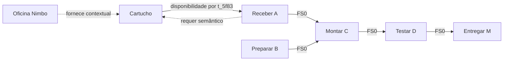

# Etapa 3 — grafo e regras de dependência

24/10/2026, America/Sao_Paulo. **Entregue aguardando revisão do coordenador e usuário.** Após revisar a etapa 2, o usuário disse “Avance para a próxima etapa”: aprovação da etapa 2 e autorização da etapa 3 registradas. Etapas 4–11 não iniciadas. Aprovação do usuário não constitui revisão humana independente.

## Entrega e inventário

Pacote `TCC_Codigos/data/desenvolvimento/projeto_minimo_grafo_v1/`: EstadoProjeto normalizado, projeção causal auditável, cinco fontes base copiadas literalmente, manifesto de proveniência, README e validador stdlib. Derivado do snapshot aprovado projeto_minimo_v1, sem modificá-lo. Não foram consultados gabaritos para construir arestas, regras ou condições.

Sete entidades: Oficina Nimbo n_73fa, cartucho n_c820, receber n_42be (A), preparar n_915c (B), montar n_a367 (C), testar n_08df (D), entregar n_e659 (M). Quatro atividades e marco com id=entidade_id; seis relações semânticas; cinco arcos causais; uma regra de transferência, uma local e uma temporal de custo. Cinco pisos contratuais preservados por ID mais uma restrição derivada identificada. Cinco parcelas únicas preservadas.

## Mapa e semântica auditável



As duas setas A/X no desenho pertencem a camadas distintas; não são ciclo da projeção executável. AP é parcela/regra vinculada ao fim de M e não aparece como tarefa ou aresta temporal.

| Relação | Sentido semântico | Fonte literal | Efeito permitido |
|---|---|---|---|
| l_0f81 fornece | n_73fa → n_c820 | d_71ba L02 / f_11ebeff90b | Contexto; nenhum arco causal |
| l_b6d2 requer | n_42be → n_c820 | d_aa83 L01 / f_aab5d508ec | t_5f83 projeta X→A e materializa r_d61b |
| l_938a precede_FS | n_42be → n_a367 | d_aa83 L02 / f_e847b102df | Predecessor→sucessor, lag0 |
| l_263e precede_FS | n_915c → n_a367 | mesma passagem | Predecessor→sucessor, lag0 |
| l_d405 precede_FS | n_a367 → n_08df | mesma passagem | Predecessor→sucessor, lag0 |
| l_8a19 precede_FS | n_08df → n_e659 | mesma passagem | Predecessor→sucessor, lag0 |

FS é semântica temporal nativa do contrato; não foram inventados quatro objetos RegraTransferencia fora do catálogo aprovado. Esse catálogo contém somente a transformação requer específica. O vínculo t_5f83→l_b6d2→r_d61b preserva direção semântica, origem de atributo e atividade alvo. O piso r_559aea de A permanece D0 ao lado da disponibilidade D2, sem substituir sua identidade. Demais pisos: r_df7e70, r_6b23c0, r_3f39d5, r_08f271.

## Normalização e fronteiras

Conhecimento preenche estado, valor, direção, evidências, lacunas e motivo. Valores absolutos exatos usam direção desconhecida, pois não representam deltas. `unidade` é metadado adicional explícito; disponibilidade recebe invólucro tipo/unidade/conhecimento. Ausência de atributo temporal no fornecedor não é duração zero. Não foram criados resultados por nó para representar inaplicabilidade antes de execução.

`u_813c` referencia d_8c23 L01/L02 e permite confirmar manutenção de duração e ausência de parcela adicional sob condição interpretada posteriormente. Não resolve aceite por cenário, não cria booleano satisfeito, não presume aceite pela existência de laudo. Sem aceite, a cláusula exige definição técnica e não oferece duração/custo substitutos. Propostas fora de catálogo e novos aditivos requerem validação futura, sem aprovação global aqui.

`c_724f` referencia d_59c1 L01–L03: p_c8a0, intervalo D0→fim M, dez dias contratados, taxa 10000 centavos/dia, sem_credito. Fixo base 100000 e incidência base zero documentados; obrigação consta uma vez no livro. Nenhum custo acumulado por nó ou parcela duplicada. A regra é declarativa e não executada nesta etapa.

Completude: entregas em d_71ba L05; custos em d_482e L02/d_59c1 L02; relações em d_aa83 L03. São declarações autorais fictícias, não prova empírica de fechamento externo. D10/R$5.000 são referências factuais declaradas de d_71ba L06. A soma das parcelas é conferida; o cronograma e incidências não são recalculados por motor. O futuro motor da etapa 4 deve conferir baseline antes de permitir execução, conforme contrato.

Seleção positiva de cinco documentos base, sem oito avisos, referências, listas de afetados ou resultados esperados. O manifesto preserva destinação: d_aa83 exclusivo H/T; vínculos genuinamente comuns incluem fornecedor/cartucho, completude, montagem/lote e apoio/marco. Trechos mistos são preservados literalmente com proveniência, sem recorte que suprima contexto. Isso não implementa views nem assegura equivalência de conhecimento entre condições. EstadoProjeto é base relacional para integração futura, não input B pronto.

## Validação reproduzível e revisão

```sh
python3 TCC_Codigos/data/desenvolvimento/projeto_minimo_grafo_v1/validar.py
```

Resultado: OK para hashes dos nove arquivos de origem usados, 17 trechos base literais, IDs/referências/tipos/unidades, atividades, cinco pisos preservados e restrição derivada, direção/regra da projeção, DAG FS e DAG causal, convergência A/B em C, alcance de todas as atividades até M, exclusão contextual do fornecedor, parcelas preservadas, soma do orçamento e catálogos. Validador específico confronta o mapa declarado de relações/fontes desta versão, não extrai semântica automaticamente de linguagem natural.

Seis contraprovas em cópias em memória foram rejeitadas nos pontos esperados: endpoint inexistente (ENDPOINT_INVALIDO), requer invertido (REQUER_DIRECAO), projeção invertida (PROJECAO_DIRECAO_REGRA), arco M→C criando ciclo (CICLO), piso de A alterado para D2 (PISO_PRESERVADO), duração em hora (UNIDADE). Não são previsões de cenário; os dados originais ficam intactos. Contagem de fontes confirmada no arquivo, sem testes históricos.

Conferência autoral dos endpoints e trechos: d_aa83 nomeia A/B→C→D→M e declara A/B sem predecessores temporais; L01 autoriza somente o requisito X→A; d_71ba L02 classifica fornecimento como contextual. A validação automática não prova sustentação semântica de futuras interpretações LLM, causalidade externa, desempenho ou revisão humana independente.

Etapa 4 deverá implementar e validar cálculo de cronograma, máximos, incidência temporal, delta/livro único, baseline e estados incompletos, sem herdar respostas dos cenários. Nesta entrega não há propagação de impacto, agenda, motor genérico, LLM, API, UI/notebook, instalação, credenciais, integração do legado ou worktree textual, commit/push/PR. Entrega restrita à etapa 3; revisão deve preceder qualquer avanço.
